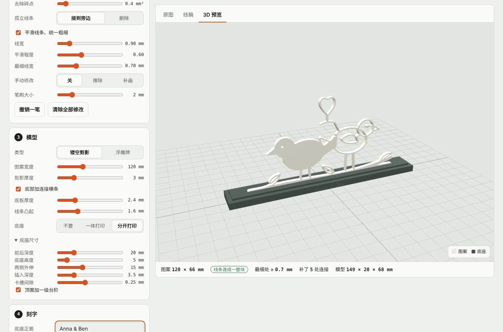

# 3D-Artifact · 线稿立体工坊

**Turn a line drawing or photo into a 3D-printable model — right in your browser.**

Everything runs locally; your images never leave your computer.

**Live demo:** https://tongchen779.github.io/3D-Artifact/



## What it makes

| Model | Input | Result |
|---|---|---|
| **Cut-out silhouette** | clean line art, sketch or photo | the lines as one connected, free-standing piece |
| **Lithophane** | photo | a flat plate that shows the photo when lit from behind |
| **Spherical lamp shade** | photo | a lithophane wrapped around a sphere, with a screw or snap-fit neck and a matching adapter ring |

Cut-outs and flat lithophanes can get an optional stand (one-piece or slot-fit) with text engraved on it.

## Features

### Cut-out silhouette
- Line art from drawings: automatic, manual or adaptive threshold, crop, invert, speck removal, and an erase/draw brush for touch-ups.
- Printable lines: thin strokes are thickened to a minimum width; floating pieces are bridged to their neighbour (or removed).
- Optional uniform-width redraw of every line along its centre, while large filled areas stay solid.

### Lithophane (flat)
- Thickness follows darkness: the photo is converted to luminance and mapped to wall thickness. Brightness falls off exponentially with thickness, so the default **physical** mapping makes the *brightness* linear in the photo (a *linear* thickness mapping is also available).
- The surface is an error-driven adaptive triangulation: points are added where it deviates from the photo, so detail is fine around eyes and outlines and coarse in smooth areas. *Smoothness* sets the tolerance (down to about 0.004 mm).
- Edge-preserving denoise, contrast, thickness range, frame and an optional *face forward* relief.
- An optional *brightness bulge* curves the plate so bright areas come forward without changing the back-lit image.
- Printed on its own, the plate is exported standing on its edge with a peel-off brim and two snap-off fins.
- A back-lit preview shows the result before printing.

### Spherical lamp shade
- The photo is wrapped on the sphere with a **Mercator** projection, so shapes are not distorted. Several copies can go around the sphere.
- **Shape**: a *band* (a zone of the sphere, open at both ends, prints without supports while its edges lean ≤ 45°) or a *full sphere* (closed top, needs supports). The support check is shown for your settings.
- **Relief on the outside or the inside** surface; the other side is a smooth ball.
- **Bottom fixing**: *screw* (internal thread on the shade, external thread on the adapter ring) or *snap* (flexible hooked tabs on the shade, a groove on the ring). Thread pitch, number of tabs, neck height and fit clearance are adjustable. The adapter ring has a flange with three screw holes.
- A back-lit 3D preview shows the lit lamp.
- Exported in use position (neck down); the shade and the ring are separate STL files.

### For all models
- **Matched to your printer**: pick printer, nozzle, layer height and wall count; lines are widened to what the nozzle can print, narrow gaps are closed, heights are rounded to whole layers, and parts that don't fit the build volume are flagged.
- **Only the relevant settings are shown** for the chosen model and mode.
- **Text engraving** (stand models): handwriting, serif or sans fonts, or upload your own `.ttf`/`.otf` (e.g. for Chinese text).
- **Export**: watertight binary STL, the line art or back-lit preview, a rendered 3D preview and print notes, individually or as one ZIP.

## Use it locally

The page loads WebAssembly and font files, so it must be served over HTTP (opening `index.html` from disk will not work):

```bash
python3 -m http.server 8000
# then open http://localhost:8000
```

## Deploy to GitHub Pages

Push to the repository, then **Settings → Pages → Deploy from a branch**, branch `main`, folder `/ (root)`. No build step is needed.

## Project structure

```
index.html            page markup
css/style.css         styles (light and dark theme)
js/raster.js          distance transform, morphology, labelling, thinning
js/lineart.js         binarise → clean → connect → smooth pipeline
js/models.js          contours → Manifold geometry, stand, text, STL and ZIP export
js/litho.js           flat lithophane: thickness mapping, adaptive triangulation, back-lit preview
js/lamp.js            spherical lamp shade: sphere mapping, thread / snap neck, adapter ring
js/app.js             UI, pipeline orchestration, 3D viewer
vendor/               three.js r128, d3 7.8.5, opentype.js 1.3.4, manifold-3d 3.5.1
fonts/                Dancing Script Bold, DejaVu Serif Bold, Inter SemiBold (Latin subsets)
```

## Credits and licences

The app code is released under the MIT licence (see `LICENSE`). Bundled libraries keep their own licences next to each file: [Manifold](https://github.com/elalish/manifold) (Apache-2.0), [three.js](https://threejs.org) (MIT), [d3](https://d3js.org) (ISC) and [opentype.js](https://opentype.js.org) (MIT). Fonts: Dancing Script and Inter (SIL Open Font License 1.1, `fonts/OFL-1.1.txt`) and DejaVu Serif (`fonts/DejaVu-LICENSE.txt`).
