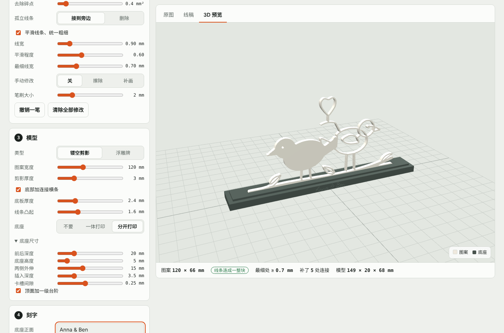

# 3D-Artifact · 线稿立体工坊

**Turn a line drawing or photo into a 3D-printable model — right in your browser.**

Upload an image and choose what to print: a free-standing cut-out silhouette or a relief plaque made from clean black-and-white line art, or a faceted lithophane that shows the photo when lit from behind. Add an optional stand (one-piece or slot-fit) with text engraved on the base. Everything runs locally in the browser; your images never leave your computer.

**Live demo:** https://tongchen779.github.io/3D-Artifact/



## Features

- **Line art from drawings and illustrations**: automatic, manual or adaptive threshold, crop, invert, speck removal, and an erase/draw brush for touch-ups.
- **Printable lines**: thin strokes are thickened to a minimum width, and floating pieces are bridged to their nearest neighbour (or removed).
- **Smooth, even strokes**: optionally re-draws every line along its centre with a uniform width, while large filled areas stay solid.
- **Three model types**:
  - *Cut-out silhouette*: the line art as a single connected piece.
  - *Relief plaque*: raised lines on a plate (two-colour ready: change filament at the plate height).
  - *Faceted lithophane*: thickness follows darkness, so the photo appears when back-lit. The surface is an error-driven adaptive triangulation — vertices are added where flat facets deviate most from the photo, so facets are small around eyes, mouth and outlines and large in smooth areas. By default the front relief is inverted (*face forward*): the front is offset by the thickness and the back by twice the thickness, so bright areas such as the face stand out while every point keeps the same thickness. The surface can be *stepped* (a few flat terraces with vertical walls, every terrace and gap at least one printable line wide and every step a whole number of layers), a *regular grid* height map (one vertex every 0.1–1 mm, like most lithophane tools), *smooth* (refined until it is within 0.02 mm of the photo everywhere, so no facet edges show) or *faceted* (a fixed vertex budget for a low-poly look). An optional *brightness bulge* curves the whole panel so bright areas (usually the face) come forward, while the thickness — and so the back-lit image — stays the same. Facet count, thickness range, contrast, bulge and frame are adjustable, and a back-lit preview shows the result before printing.
- **Print-ready lithophanes**: printed on its own, the lithophane is exported standing on its bottom edge with a peel-off brim and two snap-off side fins, so the tall thin plate prints without wobbling or tipping.
- **Matched to your printer**: pick the printer, nozzle, layer height and wall count; lines are widened to what the nozzle can print, gaps narrower than the nozzle are closed, text strokes are thickened, heights are rounded to whole layers, and parts that don't fit the build volume are flagged.
- **Stand**: none, one-piece, or a separate base with a slot (adjustable depth, height, overhang, insert depth and clearance).
- **Engraving**: text on the front and back of the base, in handwriting, serif or sans fonts, or upload your own `.ttf`/`.otf` (e.g. for Chinese text).
- **Export**: watertight binary STL files, the line art or back-lit preview, a rendered 3D preview and print notes, individually or as one ZIP.

## Use it locally

The page loads WebAssembly and font files, so it has to be served over HTTP (opening `index.html` directly from disk will not work):

```bash
python3 -m http.server 8000
# then open http://localhost:8000
```

## Deploy to GitHub Pages

Push this folder to the repository, then go to **Settings → Pages**, choose **Deploy from a branch**, branch `main`, folder `/ (root)`. The site appears at `https://<user>.github.io/<repo>/` after a minute or two. No build step is needed.

## Project structure

```
index.html            page markup
css/style.css         styles (light and dark theme)
js/raster.js          distance transform, morphology, labelling, thinning
js/lineart.js         binarise → clean → connect → smooth pipeline
js/models.js          contours → Manifold geometry, stand, text, STL and ZIP export
js/litho.js           faceted lithophane: adaptive triangulation, solid mesh, back-lit preview
js/app.js             UI, pipeline orchestration, 3D viewer
vendor/               three.js r128, d3 7.8.5, opentype.js 1.3.4, manifold-3d 3.5.1
fonts/                Dancing Script Bold, DejaVu Serif Bold, Inter SemiBold (Latin subsets)
```

## Credits and licences

The app code is released under the MIT licence (see `LICENSE`). Bundled libraries keep their own licences, included next to each file: [Manifold](https://github.com/elalish/manifold) (Apache-2.0), [three.js](https://threejs.org) (MIT), [d3](https://d3js.org) (ISC) and [opentype.js](https://opentype.js.org) (MIT). Fonts: Dancing Script and Inter (SIL Open Font License 1.1, `fonts/OFL-1.1.txt`) and DejaVu Serif (`fonts/DejaVu-LICENSE.txt`).
